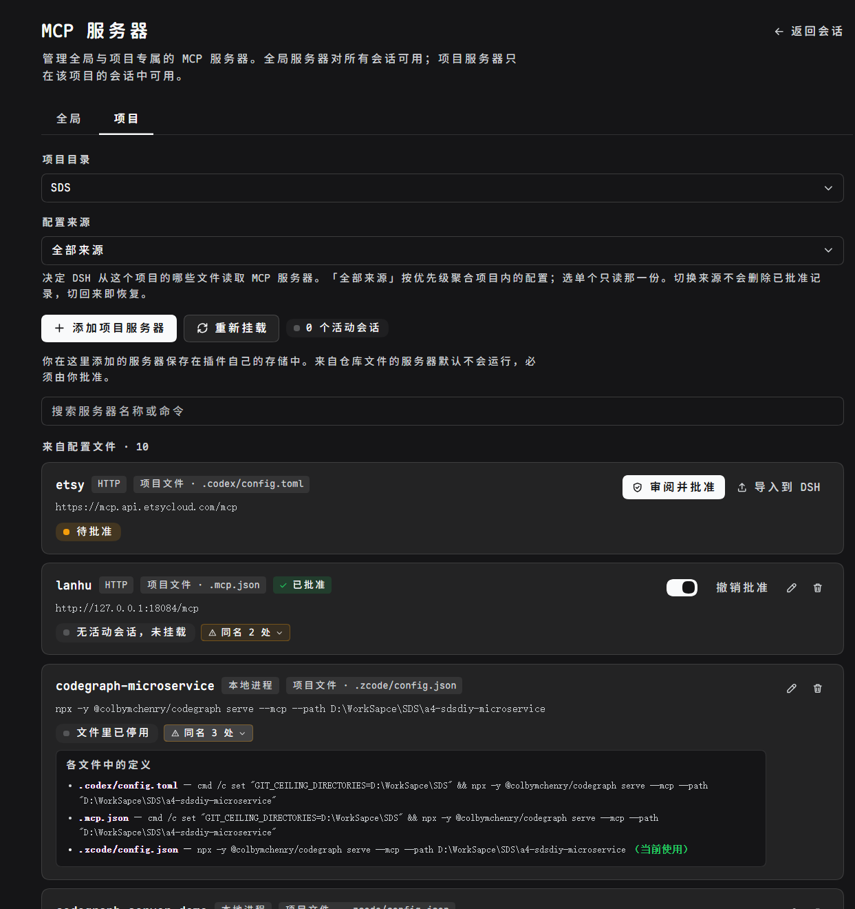

<div align="center">

# dsh-mcp-more-panel

### DeepSeek Harness 的 MCP 服务器管理面板

<a href="#安装">安装</a> · <a href="#支持读取的配置">支持的配置</a> · <a href="#安全">安全模型</a> · <a href="#兼容性">兼容性</a>

<p>
  
  <a href="./LICENSE"></a>
  <a href="#兼容性"></a>
  <a href="#兼容性"></a>
</p>



</div>

***

## dsh-mcp-more-panel 是什么

同一个 MCP 服务器要在不同工具中使用，通常需要写入各自的配置文件。这些文件的表名、传输字段、变量引用和启停写法并不一致，修改一次配置可能涉及多份文件。本插件统一读取和管理项目内的配置，减少逐个文件修改和格式转换的工作。

将全局、项目和其他 Agent 已声明的 MCP 配置集中到一个页面，支持 MCP 的新增、修改、启停、删除、测试连接与 JSON 批量导入。

面板按「全局」和「项目」两个作用域管理，全局服务器对所有会话生效，项目服务器只在该项目目录下的会话中挂载。两个项目可以分别声明同名的 `github` 服务器，各自引用独立的 token，不会共用配置。

```
项目目录
├── .codex/config.toml     # Codex（只读，可一键导入）
├── .mcp.json              # Claude Code
├── .agents/mcp.json       # 跨工具通用
├── .cursor/mcp.json       # Cursor
├── .vscode/mcp.json       # VS Code
├── .gemini/settings.json  # Gemini CLI
├── .zcode/config.json     # ZCode
├── .pi/mcp.json           # pi
└── .dsh/mcp.json          # DSH（优先级最高）

          ↓ 按优先级读取、合并，标出重复项

    面板：全局 / 项目两个页签
       ├── 已批准 ──→ 挂载到会话，模型可以使用对应工具
       └── 未批准 ──→ 只在面板显示，不启动任何进程
```

## 为什么用 dsh-mcp-more-panel

- **一个面板读取多种配置。** 项目内可能同时存在九份 MCP 配置文件，插件直接读取，不需要先导入，也不需要转换为 DSH 的格式。Codex 使用 TOML；VS Code 使用 `servers` 表，并支持 JSONC 注释；Gemini CLI 的旧写法使用 `httpUrl`。`${env:X}`、`${VAR:-默认值}` 以及 `disabled`、`enable` 等不同写法均在读取时识别。→ [支持读取的配置](#支持读取的配置)
- **仓库配置与执行权限分开。** 来自项目文件的服务器一律先标为「待批准」。完整命令行、工作目录、环境变量和请求头的值都可以在批准前查看。未经批准的服务器不会启动进程，也不会向会话注册工具。→ [安全](#安全)
- **批准绑定具体定义。** 每次批准都会保存一个 SHA-256 指纹，由命令、参数、工作目录、环境变量、地址和请求头共同计算。任何一项发生变化，指纹就不再匹配，原批准失效，运行中的服务器随之停止。批准决定是否可以运行，开关决定当前是否运行；关闭开关不会删除批准，重新批准也不会重新启用已经关闭的服务器。→ [安全](#安全)
- **全局和项目分别管理。** 全局服务器在所有会话中可用。项目服务器只在对应目录下的会话中出现，其他项目的会话无法看到或调用这些工具；同名服务器在不同项目之间也保持独立。
- **写回时保留未知字段。** 保存到项目文件时，仅替换表单负责的字段，如命令、参数和环境变量。文件中的 `dev`、`sandbox`、`oauth` 等扩展字段，以及原有缩进、换行符和 BOM 都会保留。文件包含注释，或文件在读取后被外部修改时，插件拒绝覆盖。→ [安全](#安全)
- **修改后立即生效。** 添加、修改、启停和重连都直接作用于运行中的实例，无需重启 DSH。项目文件被外部改动后，插件会在两秒内重新挂载。

## 支持读取的配置

项目目录中存在以下文件时，面板会直接读取其中的 MCP 服务器，不要求先导入，也不要求先转成 DSH 的格式。

| Agent | 文件 | 可在面板中编辑 |
| --- | --- | --- |
| Codex | `.codex/config.toml` | 只读，可一键导入 |
| Claude Code | `.mcp.json` | ✓ |
| 通用 | `.agents/mcp.json` | ✓ |
| Cursor | `.cursor/mcp.json` | ✓ |
| VS Code | `.vscode/mcp.json` | ✓ |
| Gemini CLI | `.gemini/settings.json` | ✓ |
| ZCode | `.zcode/config.json` | ✓ |
| pi | `.pi/mcp.json` | ✓ |
| DSH | `.dsh/mcp.json` | ✓ |

多个文件声明同名服务器时，表中靠后的来源优先，DSH 自身的配置优先级最高。面板会标出重复项，并可展开查看各文件中的具体定义。

「配置来源」可以按项目指定只读取其中一份文件，之后可以随时切换。切换来源不会删除已有的批准记录。

## 其他能力

| 能力 | 说明 |
| --- | --- |
| **测试连接** | 保存之前实际启动一次，报告能否连接以及可用工具的数量。测试过程不会保存任何内容。 |
| **批量导入** | 粘贴 Claude Desktop、Cursor 或 VS Code 的 `mcpServers` 配置，一次导入多个全局服务器。 |
| **接管已有配置** | `cordis.patch.yml` 中的 MCP 行可以启停，也可以修改字面量字段；`!!js` 表达式保持不变。 |
| **状态展示** | 显示已连接、连接失败及原因、待批准、需要重新批准、同名被覆盖等状态，以及每个服务器的工具数量。 |

密钥建议使用 `${变量名}`。连接时从 DSH 进程的环境变量读取，配置文件中只保存变量名。插件存储中的环境变量和请求头值在页面上显示为圆点，不发送到浏览器；项目文件中的值本来就保存在仓库中，编辑时按原文显示。

界面跟随应用的浅色和深色主题，支持中英文。

## 安装

需要 DSH `0.2.2-rc.1` 或更新版本、Node.js 22.19 或更新版本。插件尚未发布到 npm，目前从本地目录安装。

### 桌面端

先完全退出桌面应用，再执行：

```sh
dsh plugin --profile desktop add link:<本目录的绝对路径>
```

也可以直接在应用内的 **Plugin Manager** 中安装这个目录。安装后重启应用，入口位于左侧边栏「自动化任务」下方。

### Web 端

```sh
dsh plugin --profile web add link:<本目录的绝对路径>
```

安装后重启 `dsh web`，再刷新页面。

**卸载**：把 `add` 换成 `remove dsh-mcp-more-panel`。桌面端也可以在 Plugin Manager 中移除。

## 安全

| 风险点 | 插件的处理 |
| --- | --- |
| **仓库文件声明可执行命令** | 文件中的服务器默认不启动。必须先在面板中审阅并批准，才会挂载。 |
| **需要审阅服务器行为** | 批准对话框提供完整命令行、工作目录，以及环境变量和请求头的值，同时列出会读取的环境变量。下载后执行、通过 shell 执行、运行仓库文件、设置会加载额外代码的环境变量等情况会被明确标出。 |
| **已经信任的配置发生变化** | 批准记录保存当前定义的 SHA-256 指纹。命令、参数、工作目录、环境变量、地址或请求头发生变化时，原批准失效，运行中的服务器停止。 |
| **暂时停用已批准的服务器** | 开关和批准互不影响。关闭开关只停止运行，不删除批准；重新批准修改后的定义，也不会重新启用已停用的服务器。 |
| **模型尝试修改 MCP 配置** | `mcp_servers` 工具仅提供列出和诊断两个动作，没有写入配置或批准的途径。 |

配置、批准记录和项目文件写回前的备份都放在 `<DSH_HOME>/dsh-mcp-more-panel/`，不随仓库分发，也不会在仓库中留下 `.bak` 文件。

写回时还有两项保护：文件带 JSONC 注释时不改写；读取之后、保存之前，文件被外部修改时不覆盖。遇到这两种情况，可以手工编辑，或导入到 `.dsh/mcp.json`。

指纹只覆盖配置内容，不覆盖命令运行时读取的文件。批准 `node server.js` 后，即使 `server.js` 再被修改，当前批准仍然有效；`npx -y` 每次启动也可能获取新版本。批准对话框会标出这两种情况。

## 兼容性

- DSH `0.2.2-rc.1` 及更新版本，Node.js 22.19 及更新版本。依赖宿主提供的 `@deepseek-ai/dsh-mcp-client` 和 `@deepseek-ai/dsh-tools`。开发和测试环境为 DeepSeek Harness Desktop（Windows 11，desktop profile）。
- 支持 stdio 和 Streamable HTTP，不支持 SSE 和 OAuth。
- 不要同时安装 `dsh-project-mcp`、`dsh-mcp-autoload`。它们会按自己的规则加载同一批文件，绕过这里的批准。
- 会话中途切换工作目录不会切换项目。会话仍使用创建时识别的项目配置。

## 许可

[MIT](./LICENSE)
